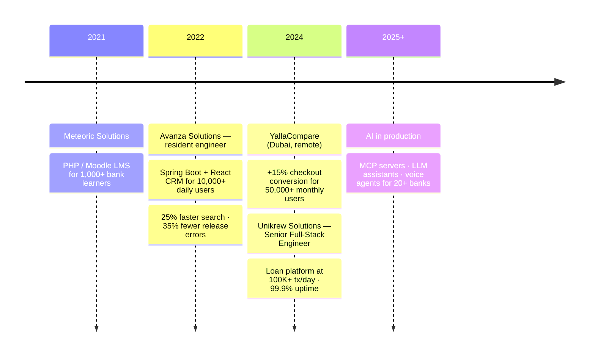

<!-- ===================== HEADER ===================== -->
<p align="center">
  
</p>

<p align="center">
  
</p>

<p align="center">
  <a href="https://www.linkedin.com/in/salalyousuf"></a>
  <a href="https://salalyousuf.netlify.app/"></a>
  <a href="mailto:salalyousuf123@gmail.com"></a>
  
</p>

<!-- ===================== IMPACT ===================== -->
<h3 align="center">⚡ Impact in Production</h3>

<p align="center">
  
  
  
  
  
  
</p>

---

<!-- ===================== WHOAMI ===================== -->
### 🧑‍💻 `whoami`

```python
class SalalYousuf(Engineer):
    role        = "Senior Full-Stack Engineer @ Unikrew Solutions"
    based_in    = "Karachi, Pakistan  →  open to relocation"
    experience  = "5 years in FinTech, 4+ embedded on site at enterprise banks"

    builds = [
        "Loan origination microservices — C#/ASP.NET Core, Java/Spring Boot, Kotlin",
        "MCP servers that give LLMs access-controlled tools into live banking systems",
        "OpenAI- & Claude-powered assistants and voice agents",
        "Deep-learning OCR & transliteration models (Urdu/English documents)",
    ]

    believes = "Don't trust a model — measure it: accuracy, safety, cost, latency."

    currently_exploring = ["Agent evaluation", "Prompt-injection defence", "Fraud & risk systems"]
```

---

<!-- ===================== WHAT I DO ===================== -->
### 🧭 Three Things I'm Good At

<table>
<tr>
<td width="33%" valign="top">

#### 🏦 FinTech Backends
Loan origination & management microservices handling **100K+ transactions/day at 99.9%**. Biometric (NADRA), OCR and NIC integrations with **35% lower latency**. SSO, SAML, OAuth 2.0/OIDC done right.

</td>
<td width="33%" valign="top">

#### 🤖 AI in Production
MCP servers exposing loan APIs, databases and OCR as **access-controlled tools**. LLM assistants at **1,000+ conversations/month**. Voice agents that resolve or route **70%+ of calls**.

</td>
<td width="33%" valign="top">

#### 🤝 Embedded with Clients
Named first-call engineer for **20+ banks**. Diagnose from logs, traces & SQL — **40% faster resolution**. Runbooks and KB articles that cut **repeat tickets by 25%**.

</td>
</tr>
</table>

---

<!-- ===================== STACK ===================== -->
### 🛠️ Stack

<p align="center"><sub><b>LANGUAGES</b></sub><br/>
  
  
  
  
  
  
  
</p>

<p align="center"><sub><b>BACKEND & MESSAGING</b></sub><br/>
  
  
  
  
  
  
</p>

<p align="center"><sub><b>AI & ML</b></sub><br/>
  
  
  
  
  
  
  
  
</p>

<p align="center"><sub><b>DATA</b></sub><br/>
  
  
  
  
  
  
</p>

<p align="center"><sub><b>CLOUD, DEVOPS & FRONT END</b></sub><br/>
  
  
  
  
  
  
  
</p>

---

<!-- ===================== PROJECTS ===================== -->
### 🧪 Featured Projects — *measured, not vibes*

| | Project | Result |
|:-:|---|---|
| 📜 | [**sbp-regulations-rag**](https://github.com/Salal10/sbp-regulations-rag)<br/><sub>Python · FastAPI · Gemini · pgvector · Docker</sub> | RAG over central-bank regulations with code-enforced citations. **95.2% top-5 retrieval** vs 71.4% for keyword search; refused **10/10** out-of-scope questions on a 52-question eval set. |
| ⚖️ | [**loan-agent-vs-workflow**](https://github.com/Salal10/loan-agent-vs-workflow)<br/><sub>Python · Tool Calling · C#/.NET · xUnit</sub> | Same loan pre-check built twice — tool-calling LLM agent vs fixed workflow — on a .NET banking API, compared on accuracy, safety and cost with a **prompt-injection eval set**. |
| 🎙️ | [**urdu-bank-voice-agent**](https://github.com/Salal10/urdu-bank-voice-agent)<br/><sub>Whisper · MMS · Gemini · .NET</sub> | Urdu voice assistant for bank customer calls: local speech recognition and synthesis, LLM understanding, and a .NET banking API behind it. |
| 🧮 | [**banking77-llm-vs-ml**](https://github.com/Salal10/banking77-llm-vs-ml)<br/><sub>Gemini · Groq · scikit-learn</sub> | Benchmarked LLMs against a TF-IDF baseline on 77-intent classification — showed a **hybrid beats either alone** on accuracy, cost and latency. |
| 🎫 | [**support-ticket-triage**](https://github.com/Salal10/support-ticket-triage)<br/><sub>scikit-learn · FastAPI · pytest</sub> | Cross-validated classifier routing banking support messages into 77 categories, **flagging low-confidence cases for human review**. |

---

<!-- ===================== JOURNEY ===================== -->
### 🗺️ Journey



---

<!-- ===================== STATS ===================== -->
### 📊 GitHub

<p align="center">
  
  
</p>
<p align="center">
  
</p>

<p align="center">
  
</p>
